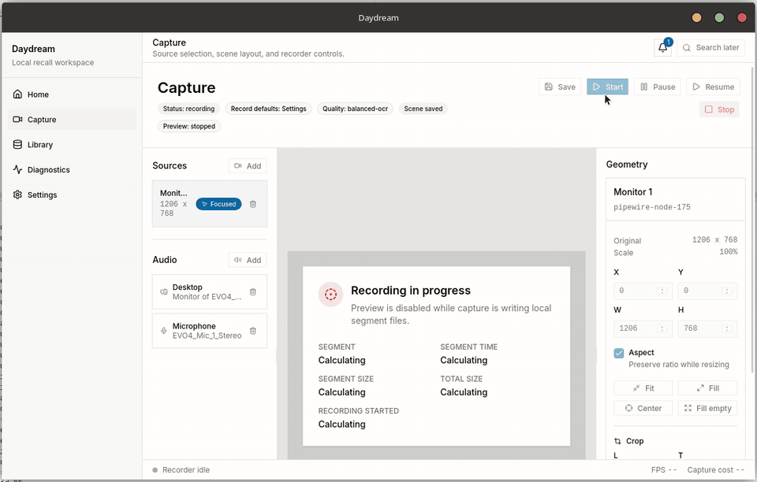

# Daydream

Record your screen and audio, then search and replay your day. Linux-first,
local-first, and still a developer alpha.



- Multi-monitor recording with separate desktop and microphone audio.
- A day timeline with playback, transcripts, waveforms and search.
- Local Whisper transcription and Tesseract OCR.
- Time-range redactions and protected-window rules.
- Optional remote AI for transcription, vision and day summaries.

Data stays local by default. Remote processing requires consent. Redactions hide
content and exclude it from processing; they do not erase original media bytes.

## Run

Requires Node 22.12+ (22.x) or 24+, Corepack, Rust 1.95+ and
[Linux dependencies](apps/desktop/README.md#linux-prerequisites).
No stable installers or Windows/macOS capture yet.

```sh
corepack yarn install --immutable
corepack yarn dev
```

[Screenshots](docs/desktop-screenshot1.png) · [Dark mode](docs/desktop-screenshot-dark.png)

Demo from a Linux session; screenshots use synthetic fixtures.

[Development](apps/desktop/README.md) · [Tests](docs/agent-validation.md) ·
[Privacy](docs/processing-privacy-boundaries.md) · [Contributing](CONTRIBUTING.md) ·
[Security](SECURITY.md)

[AGPL-3.0-or-later](LICENSE). [Third-party notices](THIRD_PARTY_NOTICES.md).
