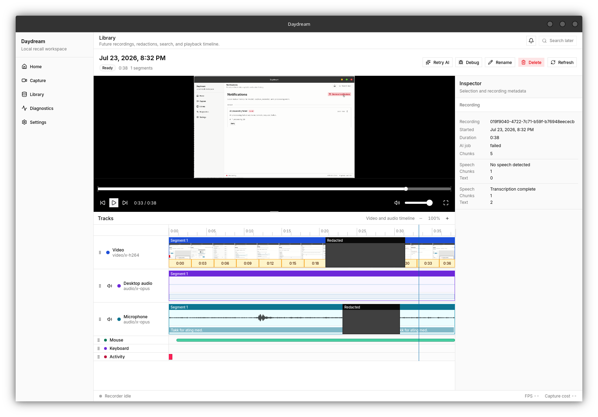
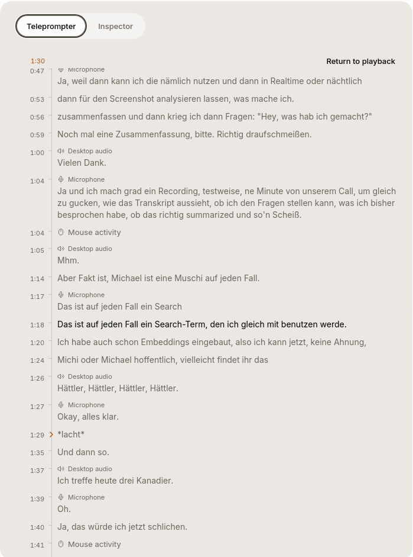

# Daydream

Daydream is a local-first desktop recall assistant for answering one question:
**what did I do today?**

It records screen, audio, activity, and window context on hardware you control,
then turns that evidence into a timeline you can review and process locally.



> [!WARNING]
> Daydream is a Linux-first developer alpha. There are no stable packaged
> releases yet, and several product areas are still under active development.

## What works today

- Multi-monitor capture through the Linux desktop portal and PipeWire.
- Source controls for monitor crop and output scale, with shared frame interval
  and bitrate. New recordings keep each monitor in its own MKV video stream.
- Separate desktop and microphone audio streams in local MKV segments.
- Optional local speaker-bleed removal for saved recordings. In Studio, open the
  microphone lane's actions and choose **Remove speaker bleed**. Compare the
  original and cleaned microphone, tune sensitivity or cancellation amount, and
  apply cleanup. Originals are retained. Regenerating microphone transcripts is
  a separate action and uses the applied audio revision.
- Explicit start, pause, resume, and stop controls.
- Local Library playback with thumbnails, waveforms, track lanes, and source
  timestamps.
- Timeline redactions that exclude or invalidate overlapping derived results.
- Protected-window rules that can pause capture or create automatic redactions.
- Mouse, keyboard, frame-change, and window activity lanes without recording
  typed text or pointer coordinates.
- Resumable processing jobs for transcription, OCR, visual observations, and
  activity analysis.
- A Processing page with recording pipelines, current source sections, waiting
  reasons and scoped recovery. Studio opens an overview for its recording or day;
  neighboring OCR and observation work shares one continuous timeline indicator.
- Local transcription through vendored `whisper.cpp`.
- Automatic transcription detects language for every speech window. Three
  substantial matching detections confirm a change; bounded corrective passes
  repair tentative transcripts without pinning later detection.
- Full-frame OCR documents from local Tesseract (default) or explicitly configured
  Vision OCR. Recognized text stays internal to retrieval; source links open the
  recorded screen moment. Audio transcript excerpts remain available in playback.
- Optional OpenAI-compatible remote transcription and vision endpoints.
- Atomic provider/settings saves, anonymous Vision endpoints and a generated-image
  Vision test. Studio can select a video source or show a synchronized grid.
- A Days library that opens directly into Studio with one timeline across the
  day's playable recordings. Gaps remain visible and skip after a short countdown;
  the next media group is preloaded. A recording picker and day review sit above
  continuous source tracks. Review and Details retain their state during processing;
  dense annotations group when zoomed out, and selected ranges support padded zoom.
- Durable local waveform jobs prepare reusable audio envelopes independently of AI.
  Timeline reads use cached viewport tiles rather than decoding media on demand.
- New visual-processing jobs describe material screen changes. Matching Vision OCR
  and observations share one frame request when their provider and model agree;
  each response section is validated independently. Existing jobs keep their protocol.
- Factual capture coverage, cited AI interpretations, editable local tasks,
  corrections and review history. Broken recordings stay out of day playback;
  playable portions of partial recordings remain available.
- Local text and semantic search over eligible OCR and both transcript tracks,
  with links to the exact source in Studio, without displaying raw OCR.
- Managed multilingual E5 and English BGE embedding models on CPU or optional
  Vulkan, plus separately enabled OpenAI-compatible embedding and generation APIs.
- A shared warm light/dark design system, responsive workspace controls and a
  persistent recording strip. New installations start in light mode.
- Rust-owned SQLite storage with embedded migrations.

## Recorded by Daydream

The demonstration below was recorded by Daydream itself. The animation is
silent; the original desktop and microphone tracks were not added to this
repository.


## Privacy model

Daydream handles screen recordings, audio, OCR, transcripts, window titles,
activity patterns, and generated observations. The default architecture keeps
that data on the local machine.

- Captured content is not uploaded by default.
- Remote AI providers require explicit configuration.
- API keys are stored through the backend rather than exposed to React.
- Raw frames, audio, OCR text, transcripts, prompts, and window titles are not
  written to normal logs.
- Redacted ranges are excluded from later processing and hidden or invalidated
  in derived results.
- Input activity records timing and state, not key values, typed text, pointer
  coordinates, or clicked content.
- Vision OCR sends original full-frame images only when selected and configured;
  it is independent of screen-observation processing. Existing OCR data is
  reconstructed locally without an automatic remote request.
- Remote embeddings and Day generation each require their own enabled profile;
  selecting Vision does not enable those uploads. Local feedback stays local.
- Recall results, prompts and vectors retain source lineage. Changed redactions
  withhold affected interpretations and tasks, including uncited prompt inputs.
- Recording state stays visible and user-controlled.

The codebase treats deletion and redaction as data-model concerns, not visual
filters. Work is still ongoing to make physical media deletion and every
downstream cleanup path equally complete.

## Current limits

- Development and real capture testing currently focus on Linux, especially KDE
  Plasma on Wayland. Windows and macOS capture adapters are not implemented.
- Day interpretations and tasks require a configured text-generation endpoint.
  They remain proposals for review; cited conversational question answering is
  still planned work.
- Ambiguous legacy source timing is excluded from timed recall until repaired.
  GPU embeddings require a feature-enabled build and compatible Vulkan runtime.
- There is no stable installer, automatic updater, or supported release channel.
- Some Linux capabilities depend on desktop portal, PipeWire, GStreamer,
  Tesseract, input-device permissions, and compositor support.
- Full GPU composition and hardware encoding remain future work.
- Playback speeds above 1x are not yet reliable in Linux's streaming WebKit path.
- Optional remote model endpoints can receive private content when the user
  enables and configures them.

## Architecture

Daydream is a Yarn 4 monorepo:

- `apps/desktop`: Tauri 2, React, Vite, Tailwind, shadcn components, TanStack
  Router, and Zustand.
- `apps/desktop/src-tauri`: Rust capture, playback, processing, settings,
  diagnostics, and SQLite ownership.
- `packages/shared`: TypeScript contracts shared across the desktop boundary.
- `packages/ffmpeg`: development FFmpeg resolution through `ffmpeg-static`.
- `packages/eslint-config` and `packages/tsconfig`: shared project tooling.

The Linux recorder uses xdg-desktop-portal and PipeWire for screen sources,
GStreamer for segmented media writing, and separate desktop and microphone
audio tracks. Processing handles finalized fragments during recording or after
stop, according to the selected timing setting, in bounded, resumable chunks.

New transcription jobs use local Silero VAD to follow speech across contiguous
audio fragments. Long utterances use bounded overlapping windows; unfinished
live speech waits for neighboring audio or recording stop. Studio hides stale
transcript items during reprocessing and reveals published replacements behind
one animated curtain per audio source. Existing jobs retain their saved strategy.

```text
capture
  -> local MKV segments and activity metadata
  -> redaction-aware chunk planning
  -> transcription, OCR, activity, and optional vision processing
  -> SQLite-backed timeline results
  -> local playback and review
```

React does not access SQLite, native capture APIs, media writers, or model
runtimes directly. Typed Tauri commands own those boundaries.

OCR recognizes full snapshots at the configured frame-recognition sampling rate.
New work defaults to local OCR with adaptive sampling: it checks at most one
frame every five seconds, recognizes material changes and takes a full checkpoint
every 30 seconds. Exact duplicates retain sampled occurrences through cache reuse;
other omitted samples are gaps, not confirmed unchanged text. Full sampling remains
available in processing preferences. Existing jobs retain their saved policy.
Processing's **Use fast local processing** action drains active visual owners and
replans OCR and optional observations with local adaptive OCR, preserving completed
audio, activity and waveforms. Descriptions have separate capacity, so a slow
Vision request does not block OCR on the next recording. Search shows eligible
OCR and transcripts while descriptions and semantic indexing continue.
Exact-image reuse reduces repeated engine calls while retaining sampled occurrences;
whitespace-only text grouping preserves source timestamps and splits at redactions.
Settings select the OCR engine separately from screen observations. Retry keeps a
job's pinned configuration; explicit OCR reprocessing uses current settings without
rerunning audio. Day review combines consecutive coverage spans and shows queued,
running and failed summary jobs. See [OCR document behavior](docs/ocr-documents-design.md) for schema,
legacy reconstruction, provider failure and privacy details.

Recall indexes current available OCR and transcripts locally, combining
FTS5 text retrieval with normalized embeddings. Long documents retain bounded,
source-linked passages. Day generation runs after a five-minute quiet period,
at most every fifteen minutes while recording; explicit regeneration remains
available. Follow-ups stay inside Daydream and never execute external actions.
Settings has six sections: General, Recording, Privacy, AI features, Models &
accounts, and Storage. Ordinary preferences save automatically. Feature and
account editors save together with Done; Cancel discards their drafts and keys.
In Models & accounts, configure connections, choose model capabilities and test
each model. AI features select compatible models and ask for remote-processing
consent with the destination and data to be sent. Storage policies require cleanup
review; ordinary preference saves do not authorize retention cleanup.
Local embeddings, Tesseract and Whisper remain available. Day summaries send
text and transcripts; choosing a Vision-capable model does not send screen images.

OpenAI connections support API keys or official ChatGPT subscription sign-in.
Subscription connections use the public Responses API and the account's available
model list. They do not support embeddings or silently fall back to API billing.
Credentials stay encrypted locally; sign-out cancels and drains account requests
before clearing tokens. Availability and limits depend on ChatGPT Settings → Usage
and the [OpenAI preview](https://developers.openai.com/siwc/token-sharing-open-source).
OpenAI-compatible services can use API keys or anonymous access and either the
Chat Completions or Responses protocol. Synthetic tests send no recordings.
ChatGPT connection diagnostics are enabled in the normal local logs. Diagnostics
shows the `daydream.log` path and can copy a debug log bundle. Filter for
`chatgpt_` and `model_test_` events: sign-in attempts include an opaque request ID,
the last authentication stage, elapsed time, HTTP status and safe error categories.
Tokens, authorization codes, callback URLs, account identities and provider bodies
are excluded. The browser callback acknowledges authorization; Daydream reports
whether token validation and local credential storage completed.
Frontend IPC, response decoding, runtime failures and failed HTTP operations also
write safe metadata to this log. Filter for `frontend_operation_failed`,
`http_operation_failed`, `model_json_invalid` and `model_response_rejected`.
Model diagnostics distinguish HTTP JSON, SSE events, completed output and
capability validation, with request IDs, stages, timings and applicable counts.
No request arguments, model output, exception messages or full API URLs are logged
by these failure reporters. New commands and safe error codes belong in the shared
diagnostic metadata policy; unknown values are categorized without being copied.
See [redesign and recall behavior](docs/recall-redesign-implementation.md) and
[embedding runtime](docs/embedding-runtime.md) for model pins, validation and limits.

## Development

### Prerequisites

- Node.js 22.12+ on the Node 22 line, or Node 24+ (Node 24 LTS recommended)
- Corepack
- Rust and Cargo 1.95 or newer (the locked `rusqlite_migration` dependency requires it)
- Linux Tauri development libraries for WebKitGTK 4.1
- PipeWire and xdg-desktop-portal
- GStreamer development headers and the base, good, bad, ugly, and PulseAudio
  plugin sets
- CMake, Clang, and libclang for the vendored `whisper.cpp` build
- Meson and Ninja for bundled WebRTC acoustic echo cancellation; Abseil headers
  and libraries version 20240722 or newer, or Meson's checksum-verified fallback
  source download during development builds
- Tesseract for local OCR

On Debian or Ubuntu, the native development packages include:

```bash
sudo apt install \
  libwebkit2gtk-4.1-dev \
  build-essential \
  curl \
  wget \
  file \
  libxdo-dev \
  libssl-dev \
  libayatana-appindicator3-dev \
  librsvg2-dev \
  libpipewire-0.3-dev \
  libpulse-dev \
  libgstreamer1.0-dev \
  libgstreamer-plugins-base1.0-dev \
  libgstreamer-plugins-bad1.0-dev \
  gstreamer1.0-plugins-base \
  gstreamer1.0-plugins-good \
  gstreamer1.0-plugins-bad \
  gstreamer1.0-plugins-ugly \
  gstreamer1.0-libav \
  gstreamer1.0-tools \
  gstreamer1.0-pulseaudio \
  cmake \
  meson \
  ninja-build \
  libabsl-dev \
  clang \
  libclang-dev \
  tesseract-ocr
```

Package names vary by distribution.

On Arch Linux or CachyOS, install the echo-cancellation build prerequisites with
`sudo pacman -S --needed meson ninja abseil-cpp`. They must be on `PATH` before
running `yarn dev`; the launcher checks Meson and Ninja before starting the build.

### Install and run

```bash
COREPACK_HOME=/tmp/corepack corepack yarn install --immutable
COREPACK_HOME=/tmp/corepack corepack yarn dev
```

On Linux Wayland, the development launcher sets
`WEBKIT_DISABLE_DMABUF_RENDERER=1` by default to avoid known WebKitGTK DMA-BUF
protocol failures.

### Quality gates

```bash
COREPACK_HOME=/tmp/corepack corepack yarn check
COREPACK_HOME=/tmp/corepack corepack yarn rust:fmt
CARGO_BUILD_JOBS=2 COREPACK_HOME=/tmp/corepack corepack yarn rust:clippy
CARGO_BUILD_JOBS=2 COREPACK_HOME=/tmp/corepack corepack yarn rust:test -- --test-threads=2
```

`check` covers JavaScript lint, typechecks and tests; native checks are separate.
See the [validation map](docs/agent-validation.md) for focused commands,
formatting, worker budgets and Playwright/loopback prerequisites.

`COREPACK_HOME=/tmp/corepack corepack yarn test:e2e` runs the combined gates and
the isolated native UI journeys. It builds fresh assets, uses synthetic capture
through the real media writer, and checks settings across a process restart.
See [production user stories](docs/user-story-validation.md) for control coverage,
failure/recovery scenarios and the device boundaries that still need operator checks.

## Project documents

Detailed design decisions and implementation history live under
[`docs/milestones`](docs/milestones):

- [Recorder foundation](docs/milestones/m1-recorder-foundation.md)
- [AI processing foundation](docs/milestones/m2-ai-processing-foundation.md)
- [Track timeline editor](docs/milestones/m2.1-track-timeline-editor.md)
- [Day index MVP plan](docs/milestones/m3-day-index-mvp.md)
- [Protected-window recording rules](docs/protected-window-recording-rules.md)
- [Full-frame OCR documents](docs/ocr-documents-design.md)

## Contributing and security

Read [CONTRIBUTING.md](CONTRIBUTING.md) before opening a change.

Do not attach real recordings, screenshots, transcripts, OCR output, window
titles, or unredacted logs to public issues. Report security problems privately
as described in [SECURITY.md](SECURITY.md).

## License

Daydream is licensed under the
[GNU Affero General Public License v3.0 or later](LICENSE).

Copyright © 2026 Felix Faust.

Third-party code, tools, models, and runtime components retain their own
licenses. See [THIRD_PARTY_NOTICES.md](THIRD_PARTY_NOTICES.md).
